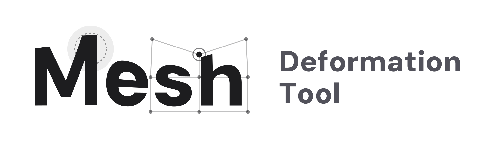

  <picture>
    <source media="(prefers-color-scheme: dark)" srcset="https://raw.githubusercontent.com/32ba/VRC-lattice-deformation-tool/2.0.0-beta.1/Blobs~/logo-white.png">
    
  </picture>

# Lattice Deformation Tool

Unity 内で `MeshRenderer` / `SkinnedMeshRenderer` の形状をレイヤーとして調整し、NDMF Preview とビルド時 Bake へ非破壊で反映する Unity 6 向けエディタ拡張です。ラティスだけでなく、ブラシ、頂点選択、マスク、BlendShape 入出力を1つのワークフローで扱えます。

衣装・髪・アクセサリのフィット調整、貫通箇所の手動修正、形状差分の BlendShape 化などに利用できます。元の Mesh アセットは変更しません。

English documentation: [README_en.md](README_en.md)

このブランチでは、既存データと機能を維持する内部リファクタリングを `2.0.0-beta.1` として開発しています。
既存コンポーネントと保存データの互換性を保ちながら、データ読取り・編集操作・変形評価・移行・Previewの管理を分離しています。InspectorとScene Viewの各ツールも、操作・計算・表示の役割ごとに整理しています。
実装済みの範囲、テスト結果、残る工程は[開発状況](https://github.com/32ba/VRC-lattice-deformation-tool/blob/2.0.0-beta.1/Docs~/Architecture/2.0.0-beta.1-progress.md)を参照してください。

## 主な機能

- **Lattice**: 制御点を動かして広い範囲を滑らかに変形
- **Brush**: Normal / Move / Smooth の3モードで局所編集
  - Smooth / Linear / Constant / Sphere / Gaussian フォールオフ
  - 表面距離フォールオフ、X/Y/Z ミラー、貫通頂点の可視化
- **Vertex Selection**: 頂点を直接選択し、Move / Rotate / Scale を適用
  - 矩形選択とプロポーショナル編集に対応
- **Group / Layer**: Lattice と Brush レイヤーを重ね、名前・有効状態・ウェイトを個別管理
  - レイヤーやグループの複製、コピー＆ペースト、並べ替えと、レイヤーの左右分割・反転に対応
- **BlendShape**: 既存 BlendShape を Brush レイヤーへ読み込み、グループまたはレイヤーを新しい BlendShape として出力
- **Mesh rebuild**: 法線、タンジェント、Bounds、SkinnedMesh の Bone Weight を必要に応じて再計算
- **NDMF Preview / Bake**: Preview 中はプロキシ Mesh で確認し、アバターまたはワールドのビルド時にだけ変形を適用

既存のProfile・Mask・高度BlendShapeデータは引き続き読み込み・評価できます。これらの次期作成編集UIとClearance/Scan/Fit/QAは2.0の出荷範囲に含めません。通常のGroup出力・テストスライダー・単一フレーム取り込みは利用できます。

## 対応対象と必要環境

- Unity 6 (6000.0) 以降（2.x系はUnity 6専用です。Unity 2022.3では1.x系を使用してください）
- `MeshFilter` + `MeshRenderer`、または `SkinnedMeshRenderer`
- NDMF (`nadena.dev.ndmf`) 1.15.0 以降
- VRChat Creator Companion（VPM から導入する場合に推奨）

## 導入

1. [VPM リポジトリ](https://vpm.32ba.net) を VCC に追加し、対象プロジェクトへ **Lattice Deformation Tool** を導入します。
2. 調整する Renderer と同じ GameObject に `LatticeDeformer` を追加します。
3. 同じ GameObject 上の Renderer は対象メッシュとして自動設定されます。別の Renderer を使う場合は、Inspector の「詳細」タブにある「対象メッシュ」で指定します。
4. 編集を始めると NDMF Preview が有効になり、Scene View で結果を確認できます。プレビューの切り替えは「詳細」タブの「メッシュ再構築オプション」にあります。

リポジトリを直接利用する場合は、VCC プロジェクトの `Packages` 以下へ配置してください。

## 更新

v2 から BOOTH での配布を終了し、VPM でのみ配布しています。新しいバージョンが出ると、`LatticeDeformer` の Inspector に通知が表示され、[ドキュメント](https://vrc.32ba.net/docs/packages/vrc-lattice-deformation-tool/overview/)を開けます。

1. VCC（または ALCOM などの VPM 対応ツール）で対象プロジェクトを開きます。
2. [VPM リポジトリ](https://vpm.32ba.net) をまだ追加していない場合は、先に追加します。
3. パッケージ一覧の **Lattice Deformation Tool** で新しいバージョンを選びます。
4. ベータ版へ更新する場合は、VCC の設定でプレリリース版の表示（Show Pre-release Packages）を有効にします。

BOOTH 版を unitypackage や zip で導入していた場合は、プロジェクトをバックアップしてから `Packages/net.32ba.lattice-deformation-tool` を削除し、VPM で導入し直してください。同じパッケージが二重に入るのを防ぐためです。

## 基本操作

1. `LatticeDeformer` の Inspector の「かんたん」タブで、やりたいことを選びます。
   - **形をまとめて変える**: メッシュを囲む箱の点を動かして、広い範囲を変形します（ラティス）。
   - **ブラシでなぞって整える**: 表面をなぞって部分的に形を変えます（ブラシ）。
   - **点をつかんで細かく動かす**: 点を選んでハンドルで動かします。
2. 必要なレイヤーが用意され、Scene View に **Mesh Deformer** オーバーレイが出ます。操作方法や範囲を選んで編集し、終わったら「完了」を押します。
3. レイヤーを分けたり重ね方を調整したりするときは「詳細」タブを開きます。「変形レイヤー」で追加・並べ替え・表示切り替え・効き具合を調整し、「選択中のレイヤー」でそのレイヤーの設定を変更します。
4. 「詳細」タブ下部の **ラティスエディターを開く** / **ブラシエディターを開く** からは、すべての設定を含むオーバーレイで編集できます。オーバーレイの「詳細」「かんたん」でも切り替えられます。
5. NDMF Preview で最終結果を確認します。
6. 通常の NDMF 対応アバター／ワールドのビルドを実行すると、生成 Mesh に変形が Bake されます。

### Scene View の主な操作

- Lattice: 制御点をクリック、Shift+クリックで追加選択し、ハンドルで移動
- Brush: Alt+スクロールで半径、Shift+スクロールで強度を調整
- Vertex Selection: クリック、Shift+クリック、Ctrl+クリック、矩形ドラッグで選択
- Vertex Transform: W / E / R で Move / Rotate / Scale を切り替え
- Proportional Editing: Alt+スクロールで影響半径を調整
- Undo / Redo: Unity 標準の Undo / Redo に対応

## 代表的なワークフロー

### 1. 衣装全体のシルエットをラティスで調整

1. 「形をまとめて変える」で編集を始めます。点の数や Bounds は「詳細」タブの「選択中のレイヤー」で対象範囲に合わせます。
2. 複数の点を選択して移動します。左右対称の衣装では「反対側も一緒に動かす」を使います。
3. レイヤーの効き具合を調整し、必要なら別レイヤーに細部の修正を分けます。

### 2. 貫通箇所を Brush で局所修正

1. 「ブラシでなぞって整える」で編集を始め、ブラシの働き（形を変える／ずらす／なめらかに）を選びます。
2. 大きさと強さを調整し、必要な範囲だけを編集します。
3. 必要に応じて、詳細オーバーレイの「表示オプション」で **貫通表示** を有効にして参照メッシュを指定し、赤く表示された頂点を修正します。
4. 頂点単位で仕上げる場合は、詳細オーバーレイで「点を動かす」に切り替えます。

貫通表示は、対象頂点と参照メッシュの最近傍三角形との位置関係を、参照面の法線方向で判定します。参照が `SkinnedMeshRenderer` の場合は現在ポーズを Bake して評価します。メッシュ同士の交差を網羅する判定ではないため、頂点間で交差する箇所などは検出できない場合があります。

### 3. 形状差分を BlendShape として編集・出力

1. Source Mesh の既存 BlendShape を「詳細」タブの **BlendShapeから読み込む** からブラシのレイヤーとして読み込みます。
2. ブラシまたは「点を動かす」で形状を編集します。
3. グループの **BlendShapeとして出力** を有効にして、出力名とカーブを設定します。
4. テストモードと NDMF Preview でウェイト変化を確認してからビルドします。

直接変形する Group と BlendShape 出力する Group は同じコンポーネント内で併用できます。

## データの扱い

- Source Mesh アセットへ頂点変更を書き戻しません。
- 変形データは `LatticeDeformer` の Group / Layer としてシーンまたは Prefab に保存されます。
- NDMF Preview は表示用のプロキシ Mesh を利用し、終了時に上流の Mesh 表示へ戻します。
- 旧 `BrushDeformer` は Inspector の明示的な移行操作で Brush Layer へコピーできます。移行後の旧コンポーネントは無効なバックアップとして保持されます。

## ライセンス

本パッケージは MIT License で提供されています。詳細は [LICENSE](LICENSE) を参照してください。
同梱しているアイコン（Tabler Icons）のライセンスと、参考にした論文は [THIRD_PARTY_NOTICES.md](THIRD_PARTY_NOTICES.md) に記載しています。
