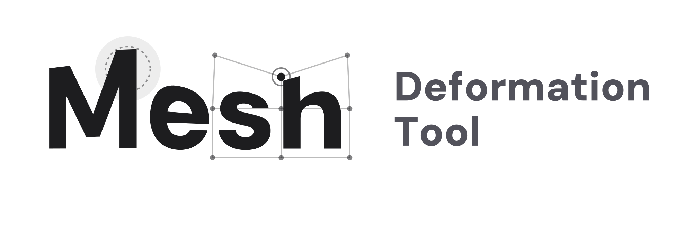

  <picture>
    <source media="(prefers-color-scheme: dark)" srcset="https://raw.githubusercontent.com/32ba/VRC-lattice-deformation-tool/2.0.0-beta.1/Blobs~/logo-white.png">
    
  </picture>

# Lattice Deformation Tool

A Unity 6 editor extension for adjusting `MeshRenderer` and `SkinnedMeshRenderer` geometry as layers, with non-destructive NDMF Preview and build-time baking. It brings lattice, brush, vertex selection, masking, and BlendShape I/O into one workflow.

Use it for fitting clothing, hair, and accessories, manually correcting intersections, or turning a shape adjustment into a BlendShape. The original Mesh asset is never modified.

日本語ドキュメント: [README.md](README.md)

This branch develops `2.0.0-beta.1`, an internal refactoring that preserves existing data and functionality.
The implementation separates data reads, editing operations, deformation evaluation, migration, and Preview management while preserving compatibility with existing components and saved data. Inspector and Scene View tools also separate interaction, calculation, and presentation responsibilities.
See the [development status](https://github.com/32ba/VRC-lattice-deformation-tool/blob/2.0.0-beta.1/Docs~/Architecture/2.0.0-beta.1-progress.md) for the implemented scope, test results, and remaining stages.

## Main features

- **Lattice**: Move control points to deform broad areas smoothly
- **Brush**: Make local edits with Normal, Move, and Smooth modes
  - Smooth, Linear, Constant, Sphere, and Gaussian falloff
  - Surface-distance falloff, X/Y/Z mirroring, and penetration visualization
- **Vertex Selection**: Select vertices directly and apply Move, Rotate, or Scale
  - Box selection and proportional editing are supported
- **Groups and Layers**: Stack Lattice and Brush layers with independent names, enabled states, and weights
  - Duplicate, copy and paste, or reorder layers and groups; split and flip individual layers
- **BlendShapes**: Import an existing BlendShape as a Brush layer and output a group or layer as a new BlendShape
- **Mesh rebuild**: Optionally recalculate normals, tangents, bounds, and SkinnedMesh bone weights
- **NDMF Preview / Bake**: Inspect changes on a proxy Mesh and apply them only during an avatar or world build

Existing Profile, Mask, and advanced BlendShape data can still be loaded and evaluated. Their future authoring UI and Clearance/Scan/Fit/QA are outside the 2.0 shipping scope. Normal Group output, the test slider, and single-frame import remain available.

## Supported targets and requirements

- Unity 6 (6000.0) or later (the 2.x line supports Unity 6 only; use 1.x on Unity 2022.3)
- `MeshFilter` + `MeshRenderer`, or `SkinnedMeshRenderer`
- NDMF (`nadena.dev.ndmf`) 1.15.0 or later
- VRChat Creator Companion (recommended when installing through VPM)

## Installation

1. Add the [VPM repository](https://vpm.32ba.net) to VCC and install **Lattice Deformation Tool** in your project.
2. Add `LatticeDeformer` to the same GameObject as the Renderer you want to adjust.
3. A compatible Renderer on the same GameObject is assigned as the target mesh automatically. To use another Renderer, set it under **Target mesh** on the Inspector's **Detailed** tab.
4. Starting an edit turns on NDMF Preview so you can check the result in the Scene view. The preview toggle is under **Mesh Rebuild Options** on the **Detailed** tab.

To use a source checkout directly, place the repository under the VCC project's `Packages` directory.

## Updating

From version 2, the package is no longer distributed on BOOTH and is available only through VPM. When a new version is released, a notice appears in the `LatticeDeformer` Inspector with a link to the [documentation](https://vrc.32ba.net/docs/packages/vrc-lattice-deformation-tool/overview/).

1. Open the project in VCC (or another VPM-compatible tool such as ALCOM).
2. If you have not added the [VPM repository](https://vpm.32ba.net) yet, add it first.
3. Select the new version of **Lattice Deformation Tool** in the package list.
4. To update to a beta, enable Show Pre-release Packages in the VCC settings.

If you installed the BOOTH version from a unitypackage or zip, back up the project, delete `Packages/net.32ba.lattice-deformation-tool`, and reinstall it through VPM, so the package is not installed twice.

## Basic workflow

1. On the **Simple** tab of the `LatticeDeformer` Inspector, choose what you want to do.
   - **Reshape with a cage**: move the points of a cage around the mesh to reshape a large area (Lattice).
   - **Sculpt with a brush**: stroke the surface to change its shape locally (Brush).
   - **Move vertices**: select points and move them with a handle.
2. The tool prepares the layer it needs and shows the **Mesh Deformer** overlay in the Scene view. Choose how to edit, make your changes, then press **Done**.
3. To split edits into layers or change how they stack, open the **Detailed** tab. Use **Deform layers** to add, reorder, show or hide layers and set their influence, and **Selected layer** to change the settings of the selected layer.
4. **Open Lattice Editor** or **Open Brush Editor** at the bottom of the **Detailed** tab opens the overlay with every option. The overlay's **Detailed** and **Simple** buttons also switch between the two.
5. Inspect the combined result with NDMF Preview.
6. Run the normal NDMF-enabled avatar or world build to bake the deformation into the generated Mesh.

### Scene view controls

- Lattice: Click a control point, Shift-click to extend the selection, and move it with the handle
- Brush: Alt+scroll changes radius; Shift+scroll changes strength
- Vertex Selection: Click, Shift-click, Ctrl-click, or drag a rectangle to select vertices
- Vertex Transform: W / E / R switches Move / Rotate / Scale
- Proportional Editing: Alt+scroll changes the influence radius
- Undo / Redo: Standard Unity Undo and Redo are supported

## Common workflows

### 1. Adjust a clothing silhouette with a Lattice

1. Start with **Reshape with a cage**. Fit the number of points and the bounds to the target area under **Selected layer** on the **Detailed** tab.
2. Select one or more points and move them. For symmetric clothing, turn on **Move the opposite side too**.
3. Tune the layer's influence and keep fine corrections in separate layers when useful.

### 2. Correct local intersections with Brush

1. Start with **Sculpt with a brush** and choose what the brush does (Reshape, Shift or Smooth).
2. Adjust the size and strength to edit only the intended area.
3. If needed, enable **Show Penetration** under **Display options** in the detailed overlay, assign a reference mesh, and correct the vertices highlighted in red.
4. For vertex-level finishing, switch the detailed overlay to **Move points**.

Penetration visualization classifies target vertices against the nearest triangles of the reference mesh, using the reference surface normals to determine the side. A reference `SkinnedMeshRenderer` is baked in its current pose for evaluation. This is not an exhaustive mesh intersection test; intersections between sampled vertices may go undetected.

### 3. Edit and output a shape adjustment as a BlendShape

1. Use **Import from BlendShape** on the **Detailed** tab to load an existing Source Mesh BlendShape as a brush layer.
2. Edit the shape with the brush or **Move points**.
3. Turn on **Export as BlendShape** for the group, then set its output name and curve.
4. Check the weight in Test Mode and NDMF Preview before building.

Groups that deform vertices directly and Groups that output BlendShapes can coexist on the same component.

## Data behavior

- Vertex changes are never written back to the Source Mesh asset.
- Deformation data is stored in the scene or Prefab as Groups and Layers on `LatticeDeformer`.
- NDMF Preview uses a display proxy and restores the upstream Mesh display when preview ends.
- A legacy `BrushDeformer` can be copied into a Brush Layer with the explicit Inspector migration action. The legacy component is retained as a disabled backup.

## License

This package is provided under the MIT License. See [LICENSE](LICENSE) for details.
The license of the bundled icons (Tabler Icons) and the paper the weight transfer draws on are listed in [THIRD_PARTY_NOTICES.md](THIRD_PARTY_NOTICES.md).
